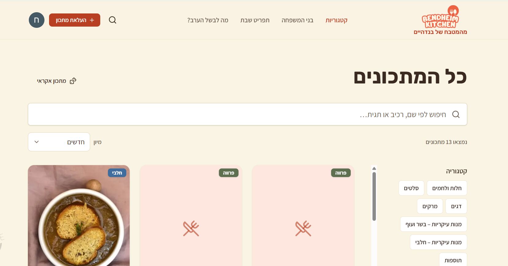
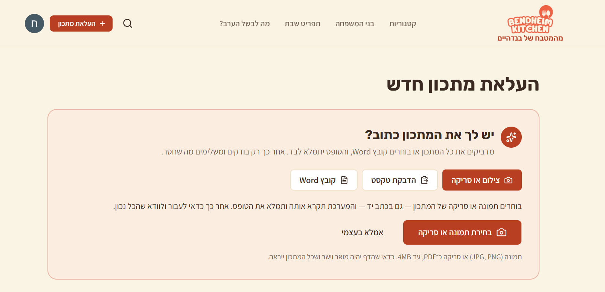
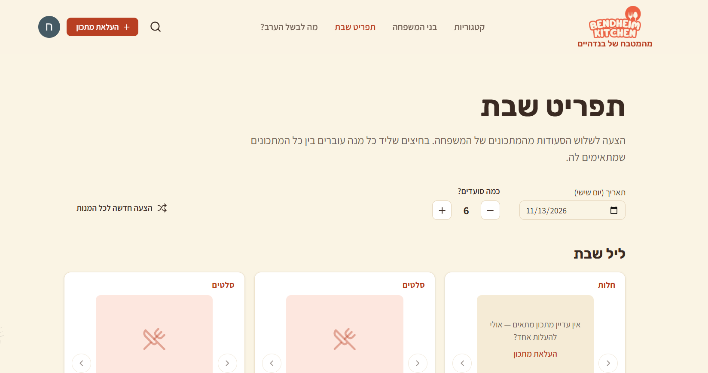

# Bendheim Kitchen: Family Recipe Platform

A private, Hebrew-language web platform where an extended family collects, shares and cooks from its recipes, and plans Shabbat and weekday meals together.

The application is in daily use by the family. Because it holds private family data, the source code lives in a private repository. This page describes the product, the architecture and my role in building it.

> **How it was built:** The application was developed with **Claude Code** (an AI coding agent). My role was product owner and technical lead: defining requirements, making the product and architecture decisions, directing development phase by phase, and testing and accepting every feature. See [My Role](#my-role) below.

## Screenshots

**All recipes: search, categories and sorting**

**Upload a recipe: paste text, upload a Word file, or read it from a photo with AI**

**Shabbat menu planner: suggests a full menu from the family's recipes**

## Features

**Recipes**
- Recipe upload and editing with autosave drafts and photos
- Smart import: paste text or upload a Word file and the recipe is parsed into fields
- Photo import: scan or photograph a handwritten recipe and it's transcribed with Google Gemini
- Hebrew full-text search that handles typos, plus filters, categories and sorting
- Kosher-aware fields (dairy, meat, parve), including "can be made parve" with substitution notes

**Cooking and sharing**
- Full recipe page with a cook mode that keeps the screen on and has built-in timers
- Ratings, comments with photos, related recipes and a print layout
- Favorites, personal collections and a shopping list

**Meal planning**
- Shabbat menu planner with saved menus, a prep timeline, a combined shopping list, and sharing
- "What's for dinner tonight" and a Sunday–Thursday weekday planner

**Platform**
- Google sign-in, restricted to an allowlist of family members
- Email notifications when new recipes are published
- Admin page for managing users and content
- Fully right-to-left (RTL) Hebrew interface, responsive from mobile to desktop

## Tech Stack

| Layer          | Technologies |
|----------------|--------------|
| Frontend       | Next.js 16 (App Router), React 19, TypeScript, Tailwind CSS, shadcn/ui (Radix), React Hook Form, Zod |
| Backend        | Next.js Server Actions and API routes |
| Database       | PostgreSQL on Supabase: Row Level Security, SQL functions, full-text search, storage |
| Auth           | Supabase Auth with Google OAuth and an email allowlist |
| AI             | Google Gemini API for reading recipes from photos |
| Email          | Nodemailer through Gmail |
| Testing        | Vitest (180+ unit tests), dedicated RLS security tests, Playwright end-to-end scripts |
| DevOps         | Vercel (EU region), GitHub Actions for database keep-alive and backups, Lighthouse audits |

## Architecture Highlights

- **Security in the database layer.** Every table is protected by Row Level Security policies, and privileges are granted explicitly per role. A separate test suite checks that users can't read or change data they shouldn't.
- **Versioned schema.** The database is built from about 20 SQL migrations: tables, RLS, search functions, storage, menus and notifications.
- **Secrets kept out of the code.** All keys live in environment variables (locally and in Vercel). None are committed to the repository.
- **Phased delivery.** The product was built in 10 planned phases. Each phase ended with automated checks (lint, type check, unit tests) and browser verification before moving on.

## My Role

I led this project from idea to production:

- **Requirements and product design:** defined the features, the user flows and the family's real needs (for example kosher categories, Shabbat planning, and access from computers only).
- **Technical decisions:** chose the stack, the hosting region, the authentication model and the free-tier services (Gemini, Gmail), and approved the database design.
- **AI-assisted development:** directed Claude Code through a written spec and a phased plan, reviewed the output, and kept a decisions log so work could continue across sessions.
- **Testing and acceptance:** tested every phase in the browser, reported issues and requested changes based on real use.
- **Deployment and operations:** set up GitHub, Vercel, Supabase, Google OAuth and the environment configuration, and handled credential safety.

## Status

Deployed to production and in active use by the family.

The source code is private. I'm happy to walk through the project, the architecture or the code in an interview.
